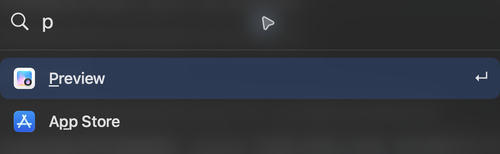

# Keylight

[English](README.md) · [简体中文](README.zh-CN.md) · [繁體中文](README.zh-TW.md) · [日本語](README.ja.md) · [한국어](README.ko.md)

macOS のアプリやローカルコマンドを素早く起動します。
省略した文字列でも検索でき、開いたアプリに応じてこの Mac 上で検索結果の順序を調整します。




## 使い始める

macOS 26 以降と Swift 6.2 以降が必要です。ビルドして開きます：

```sh
scripts/build.sh
open dist/Keylight.app
```

## ショートカット

| | |
|---|---|
| ⌘ Space | Keylight を開く |
| ↑ ↓ / Return | 結果を選択／開く |
| ⌘ M / ⌘ Z | 選択したアプリを除外／取り消す |
| ⌘ , | 設定を開く |
| ⌘ R / ⌘ Q | アプリを更新／Keylight を終了 |

設定、CLI、権限、フォントの帰属については[ガイド](docs/guide.md)（英語）を参照してください。ソースコードは [GPL-3.0-only](LICENSE)、Doto フォントは [SIL OFL 1.1](Resources/Doto-OFL.txt) です。
