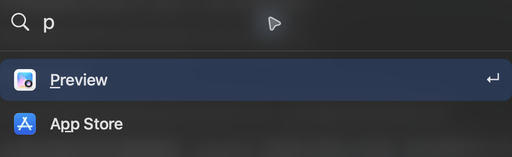

# Keylight

[English](README.md) · [简体中文](README.zh-CN.md) · [繁體中文](README.zh-TW.md) · [日本語](README.ja.md) · [한국어](README.ko.md)

macOS 앱과 로컬 명령을 빠르게 실행합니다.
축약어로 검색하고, 이 Mac에서 열었던 앱에 따라 검색 결과 순서를 조정합니다.

`add` 또는 `proj`를 입력하고 프로젝트를 선택한 뒤 요청을 작성하세요. `ADD`는 로컬에 저장하고, `PROJ`는 해당 ChatGPT 채팅을 열어 전송합니다. 설정의 Requests에서 범위, 고정 순서, 저장 위치와 사전 설정을 변경할 수 있습니다. 기본값은 `gpt-6.1-terra`, `high`, `Development`입니다.



## 시작하기

macOS 26 이상과 Swift 6.2 이상이 필요합니다. 빌드하고 여세요:

```sh
scripts/build.sh
open dist/Keylight.app
```

## 단축키

| | |
|---|---|
| ⌘ Space | Keylight 열기 |
| ↑ ↓ / Return | 결과 선택／열기 |
| ⌘ M / ⌘ Z | 선택한 앱 제외／실행 취소 |
| ⌘ , | 설정 열기 |
| ⌘ R / ⌘ Q | 앱 새로 고침 / Keylight 종료 |

설정, CLI, 권한 및 글꼴 출처는 [가이드](docs/guide.md)(영어)를 참고하세요. 소스는 [GPL-3.0-only](LICENSE), Doto 글꼴은 [SIL OFL 1.1](Resources/Doto-OFL.txt)을 따릅니다.
