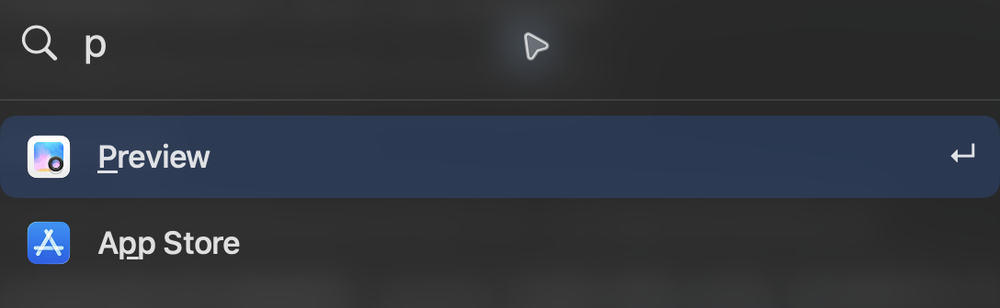

# Keylight

[English](README.md) · [简体中文](README.zh-CN.md) · [繁體中文](README.zh-TW.md) · [日本語](README.ja.md) · [한국어](README.ko.md)

A fast macOS launcher for apps and local commands.
Search matches abbreviations and learns from your app choices on this Mac.

Type `add` or `proj`, choose a project, then write your request. `ADD` saves it locally; `PROJ` opens the matching ChatGPT chat and sends it. Configure scope, pins, queue and presets in Settings → Requests. Defaults: `gpt-6.1-terra`, `high`, `Development`.



## Get started

Requires macOS 26+ and Swift 6.2+. Build and open:

```sh
scripts/build.sh
open dist/Keylight.app
```

## Shortcuts

| | |
|---|---|
| ⌘ Space | Open Keylight |
| ↑ ↓ / Return | Select / open a result |
| ⌘ M / ⌘ Z | Exclude selected app / undo |
| ⌘ , | Open settings |
| ⌘ R / ⌘ Q | Refresh apps / quit Keylight |

More options, CLI, permissions and font attribution: [Guide](docs/guide.md) (English). Source: [GPL-3.0-only](LICENSE). Doto font: [SIL OFL 1.1](Resources/Doto-OFL.txt).
