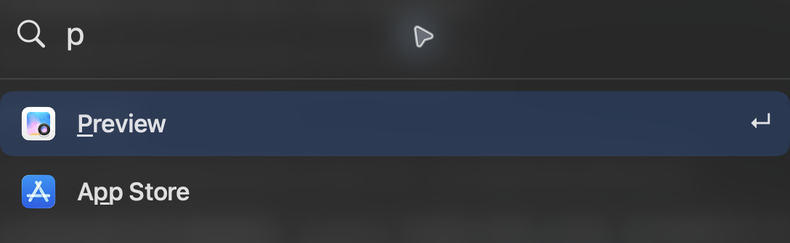

# Keylight

[English](README.md) · [简体中文](README.zh-CN.md) · [繁體中文](README.zh-TW.md) · [日本語](README.ja.md) · [한국어](README.ko.md)

快速启动 macOS 应用和本地命令。
搜索支持缩写，并在本机根据你打开的应用调整排序。

输入 `add` 选项目，新建或追加待处理请求；选中已有请求后按 ⌘Return 发送。`proj` 直接创建并发送一次性请求。已发送原文件保留，待处理项目下次仍可见。「设置 → 请求」可调整范围、置顶、队列与预设；默认为 `gpt-6.1-terra`、`high`、`Development`。

可选的请求功能需要配置 Godspeed Projects 服务；发送还需要兼容且已登录的 ChatGPT 桌面应用。在设置中开启后，`clip` 可打开本地文本历史，`emp` 打开需鼠标确认的清倒废纸篓操作。限制和权限见[指南](docs/guide.md)。

搜索「默认浏览器」或「菜单栏应用」可打开系统设置中的对应控件。这两个快捷指令需要辅助功能权限：在「系统设置 → 隐私与安全性 → 辅助功能」中允许 Keylight，然后再次运行。设置值需自行选择。



## 开始使用

需要 macOS 26+ 和 Swift 6.2+。构建并打开：

```sh
scripts/build.sh
open dist/Keylight.app
```

## 快捷键

| | |
|---|---|
| ⌘ Space | 打开 Keylight |
| ↑ ↓ / Return | 选择／打开结果 |
| ⌘ M / ⌘ Z | 排除所选应用／撤销 |
| ⌘ , | 打开设置 |
| ⌘ R / ⌘ Q | 刷新应用／退出 Keylight |

更多设置、CLI、权限与字体署名见[指南](docs/guide.md)（英文）。源码采用 [GPL-3.0-only](LICENSE)；Doto 字体采用 [SIL OFL 1.1](Resources/Doto-OFL.txt)。
