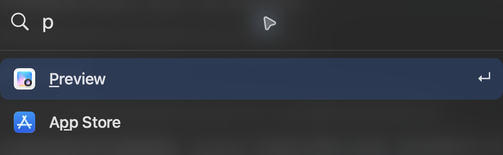

# Keylight

[English](README.md) · [简体中文](README.zh-CN.md) · [繁體中文](README.zh-TW.md) · [日本語](README.ja.md) · [한국어](README.ko.md)

快速啟動 macOS App 和本機指令。
搜尋支援縮寫，並在本機依你開啟的 App 調整排序。

輸入 `add` 選專案，新增或追加待處理請求；選取既有請求後按 ⌘Return 傳送。`proj` 直接建立並傳送一次性請求。已傳送原檔保留，待處理項目下次仍可見。「設定 → 請求」可調整範圍、置頂、佇列與預設；預設為 `gpt-6.1-terra`、`high`、`Development`。



## 開始使用

需要 macOS 26+ 和 Swift 6.2+。建置並開啟：

```sh
scripts/build.sh
open dist/Keylight.app
```

## 快捷鍵

| | |
|---|---|
| ⌘ Space | 開啟 Keylight |
| ↑ ↓ / Return | 選取／開啟結果 |
| ⌘ M / ⌘ Z | 排除所選 App／復原 |
| ⌘ , | 開啟設定 |
| ⌘ R / ⌘ Q | 重新整理 App／結束 Keylight |

更多設定、CLI、權限與字型署名見[指南](docs/guide.md)（英文）。原始碼採用 [GPL-3.0-only](LICENSE)；Doto 字型採用 [SIL OFL 1.1](Resources/Doto-OFL.txt)。
